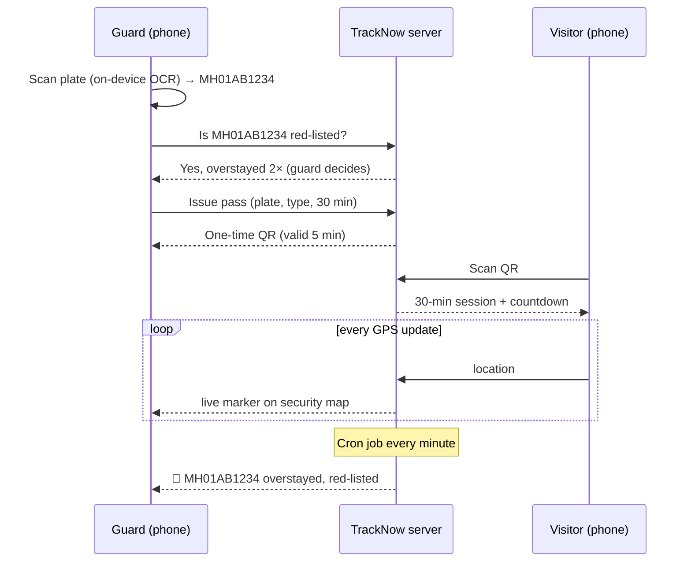

# TrackNow: Campus Vehicle Tracking & Visitor Pass System

TrackNow is a web app for a large residential campus (built around IIT Bombay's road network). It does two jobs:

1. **Public transport tracking**: students see campus buggies, shuttles and autos moving live on a map, and can tap **"I'm here"** so drivers know where people are waiting.
2. **Visitor vehicle management for security**: a guard at the gate scans a visiting vehicle's number plate with the phone camera (OCR), issues a **one-time QR pass** with a time limit, and sees every visitor vehicle live on a map. Vehicles that overstay are **automatically red-listed**, and the guard is alerted the next time that plate shows up.

> **Live app:** _add your deployed link here_ · **Demo video:** _optional_

---

## The problem

**Students.** Campus transport has no schedule anyone can rely on. You walk to a stop and either the buggy just left, or it's on the other side of campus. Drivers also can't tell where demand is, so they drive fixed loops while people wait elsewhere.

**Security.** Delivery vans, cabs, construction trucks and guests enter all day. Today the gate writes the plate in a register by hand. Nobody knows where a visitor vehicle is once it's inside, or whether it ever left, and repeat overstayers aren't flagged because the register isn't searchable.

## What it does

| Who | What they can do |
|---|---|
| **Student** | See live positions of all active campus vehicles · share "I'm here" (opt-in, stops on logout) |
| **Driver** | Share live GPS location of their vehicle every 5 s (identity comes from login, so it can't be spoofed) |
| **Security guard** | Scan a plate with the camera (OCR) or type it · see a warning if the plate is red-listed · issue a QR pass for N minutes · see all visitor vehicles live on a map · get a pop-up alert when a pass expires · remove a visitor |
| **Visitor (driver of a guest vehicle)** | Scan the QR → no app install, no account → countdown timer, location shared with security only |

### Visitor flow



## Number plate OCR

Typing plates at a busy gate is slow and error-prone, so the guard can point the camera at the plate instead. OCR runs **entirely in the guard's browser** (Tesseract.js), so no photo is uploaded anywhere.

Generic OCR on a whole photo works poorly, so the pipeline ([`frontend/src/ocr/`](frontend/src/ocr/)) adds three steps:

1. **Locate the plate**: threshold the image based on the centre of the frame, then flood-fill the light plate region and crop to it (drops the car body, bumper and the plate's border).
2. **Read** the crop with Tesseract (A–Z, 0–9 only).
3. **Fix the text using the plate format** (`SS DD L[L] NNNN`). Because we know which positions must be letters and which must be digits, look-alike swaps (`O↔0`, `I↔1`, `B↔8`, `S↔5`…) are corrected deterministically. The state code is checked against the list of Indian state codes. Two-row plates and the "IND" mark on HSRP plates are handled.

The guard always sees the result with a confidence level (green / amber / red) and confirms it. OCR **suggests**, the human decides.

Measured on 150 synthetic plates ([full eval](docs/EVALS.md#3-ocr-accuracy-end-to-end)):

| Difficulty | Raw Tesseract | TrackNow pipeline |
|---|---|---|
| Easy | 70% | **98%** |
| Medium (tilt, noise, blur, 2-row) | 42% | **86%** |
| Hard | 30% | **56%** |

(Other image sets gave 94/84/54 and 100/78/60, so treat these as ±8 points.)

## Security & privacy decisions

- Visitor locations are sent **only to logged-in security guards** (Socket.IO room), never to students.
- Security accounts need a **signup code** from the admin; otherwise anyone could sign up as a guard and watch visitors.
- Every API route and socket connection checks a JWT **and the role**. A student token cannot issue passes, and a driver can only broadcast as the vehicle they logged in as.
- QR passes are **single-use and expire in 5 minutes**. The visit timer is computed on the server, not the phone.
- Passwords are bcrypt-hashed and never returned by the API. Users can only change their own password.
- No secrets in the repo: configuration comes from environment variables (see `.env.example`).

## Tech stack

React 19 · Leaflet + OpenStreetMap · Socket.IO · Node.js / Express 5 · MongoDB (Mongoose) · JWT · node-cron · Tesseract.js · Jest + Supertest + mongodb-memory-server

## Run it locally

Requirements: Node 18+, and MongoDB (local, or a free MongoDB Atlas cluster).

```bash
# 1. Backend
cd backend
cp .env.example .env        # then edit: MONGO_URL, JWT_SECRET, SECURITY_SIGNUP_CODE
npm install
npm run dev                 # http://localhost:5001

# 2. Frontend (new terminal)
cd frontend
npm install
npm start                   # http://localhost:3000
```

To try the security flow, sign up at **Security → Signup** using the `SECURITY_SIGNUP_CODE` you set. To act as a visitor, open the QR link on a second device (or in a private window).

## Tests & evals

```bash
cd backend  && npm test                          # 18 API + real-time evals (in-memory MongoDB)
cd frontend && CI=true npm test                  # 17 plate-parser evals
cd frontend && node evals/ocr/ocr-eval.mjs       # end-to-end OCR accuracy (use --n 150 for more images)
```

What each eval checks, and the results: **[docs/EVALS.md](docs/EVALS.md)**.

## Deploy

- **Backend** → Render (Web Service, root `backend`, start `npm start`). A [`render.yaml`](render.yaml) blueprint is included. Set `MONGO_URL`, `JWT_SECRET`, `SECURITY_SIGNUP_CODE`, `CORS_ORIGINS=https://<your-frontend>`.
- **Frontend** → Vercel (root `frontend`, framework Create React App). Set `REACT_APP_API_URL=https://<your-backend>`.

## Project structure

```
backend/
  app.js                 Express app (routes, CORS, change-password)
  server.js              HTTP + Socket.IO + cron bootstrap
  config.js              env validation (fails fast on missing / weak secrets)
  middleware/auth.js     JWT, QR-pass tokens, role checks
  routes/                auth (user/driver/security), passes, manage visitors, visitor session
  socketserver/          /tracking (drivers ↔ students), /security (visitors → guards)
  jobs/cron.js           red-lists expired passes, alerts guards
  tests/                 API + socket evals
frontend/
  src/components/        student & driver screens, live map
  src/components2/       security & visitor screens
  src/ocr/               plate OCR pipeline + scanner UI + parser tests
  evals/ocr/             synthetic-plate OCR accuracy eval
docs/                    EVALS.md, PROMPTS.md
```

## Scope

**In scope:** live vehicle positions on campus · student demand signal · gate entry with plate OCR · time-boxed visitor passes via QR · live visitor map for guards · automatic red-listing and alerts.

**Out of scope (for now):** route/ETA prediction · fixed CCTV / ANPR camera integration · boom-barrier control · payments or fines · native mobile apps (it's a mobile-friendly web app) · Delhi-style 1-digit-district and BH-series plates in OCR · location history storage (only live positions are kept).

## Developer

Apurba Barman, IIT Bombay
